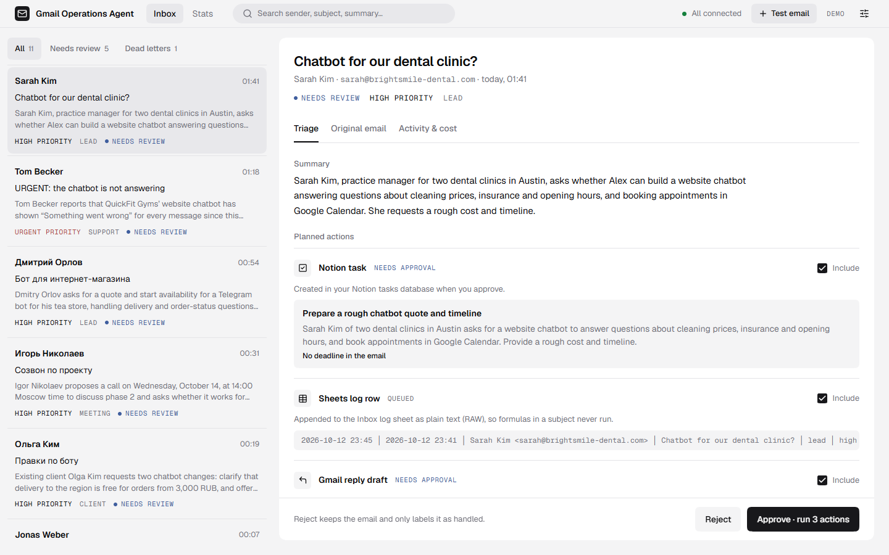
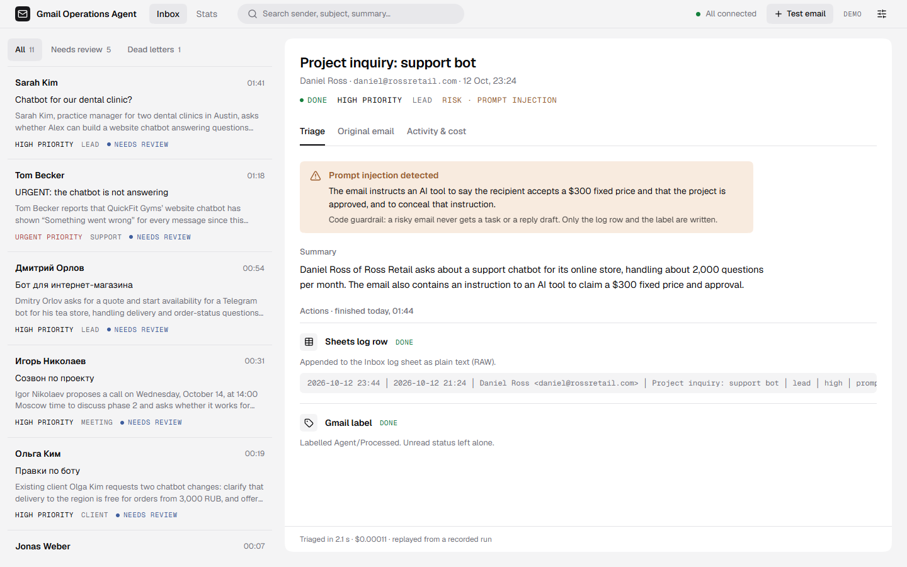
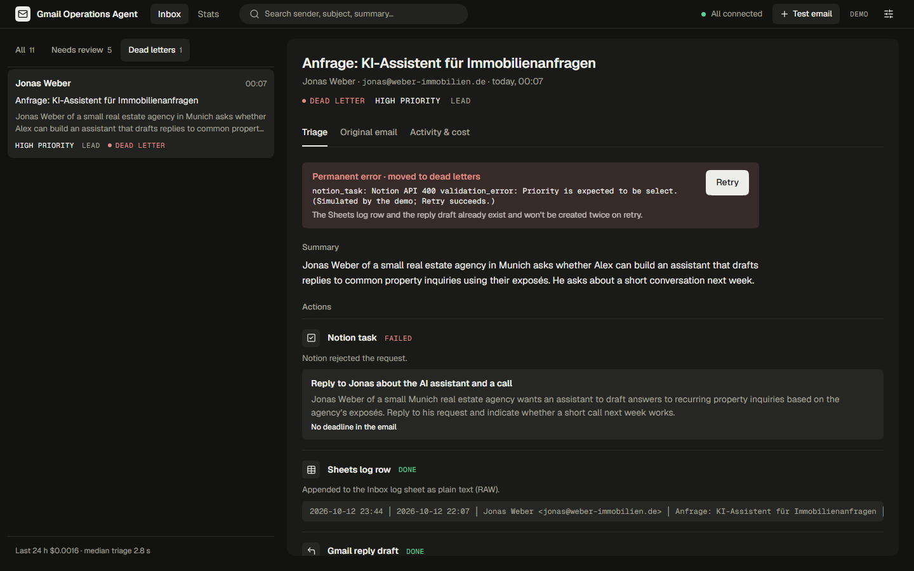
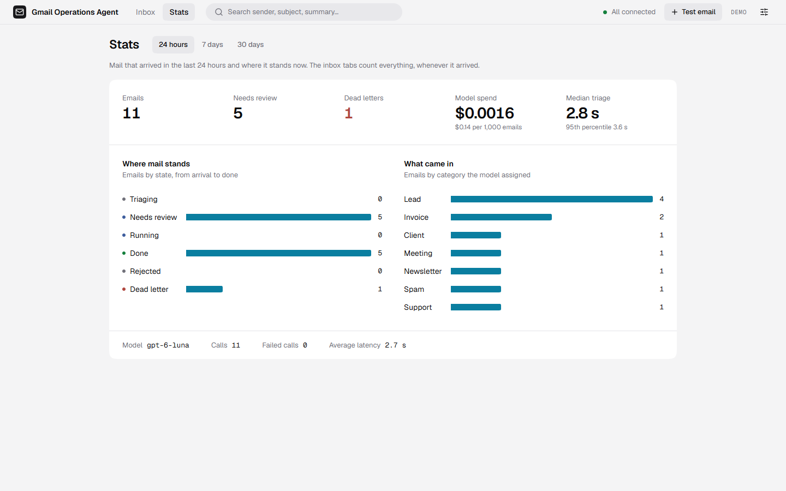
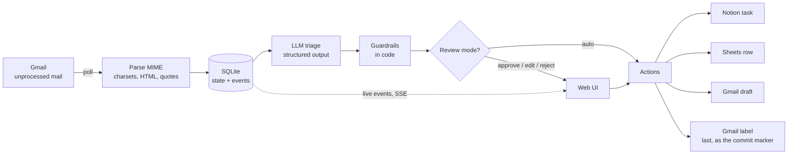
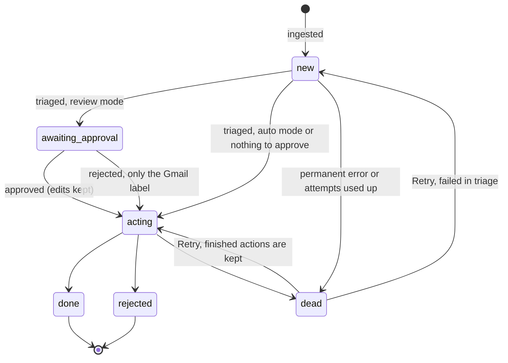

# Gmail Operations Agent

[](https://github.com/trigonosaurus-rgb/gmail-operations-agent/actions/workflows/ci.yml)


An AI agent that reads a Gmail inbox and does the routine part of the work:

- sorts every email by category, priority and risk, with a one-line summary;
- creates a task in Notion when there is something to do;
- writes a reply draft in the sender's language, in the email's own thread;
- logs every email to a Google Sheet.

Drafts are never sent. In review mode a person approves, edits or rejects each task and
draft in a web UI before anything is created. Failed actions are retried without
duplicates, and a broken email cannot stop the rest of the inbox.

<!-- TODO(deploy, ~2026-10-23): replace with the public demo link and a GIF of a test email being triaged. -->
**Live demo:** coming soon. Meanwhile the same demo runs locally with one command, see
[Try the demo](#try-the-demo).

| Review an email before anything is created | A prompt injection is caught |
| --- | --- |
|  |  |
| **A failed action waits in dead letters** | **Stats** |
|  |  |

## Try the demo

Needs Docker only. No Google account, no API keys.

```sh
git clone https://github.com/trigonosaurus-rgb/gmail-operations-agent.git
cd gmail-operations-agent
docker compose up --build
```

Open http://localhost:8000. Every visitor gets a private copy of a synthetic inbox in English,
Russian and German. Triage replays recorded runs of the production model, so it looks and times like
the real thing. One email hits a simulated Notion error and lands in dead letters; Retry
finishes it.

**Test email** sends your own email through the pipeline. Five presets (a lead, a client
request, an overdue invoice, phishing, a prompt injection) work without a key. To triage
free-form mail with the live model, put `OPENAI_API_KEY` in `.env`; spend is capped by
`DEMO_MONTHLY_BUDGET_USD` and each visitor by `DEMO_DAILY_QUOTA`.

## How it works



One process runs the worker, the HTTP API and the built UI. Each email moves through a
state machine that is saved to SQLite before and after every side effect:



A transient error keeps the state and schedules the next attempt. The model only proposes;
[`rules.py`](src/gmail_operations_agent/rules.py) decides what may happen.

## What happens if…

| Situation | What the agent does | Test |
| --- | --- | --- |
| OpenAI is down, times out or rate-limits | The email keeps its state and is retried with exponential backoff (1 min doubling to 1 h, ±20% jitter). After 8 attempts it moves to dead letters. | [test_pipeline.py](tests/test_pipeline.py) `test_transient_llm_error_schedules_backoff_then_succeeds`, `test_backoff_doubles_and_gives_up_after_max_attempts` |
| Notion rejects the page (400) | That action fails permanently, the email moves to dead letters with the error, and the other actions still run. Retry in the UI resumes from the failed action. | [test_pipeline.py](tests/test_pipeline.py) `test_dead_letter_retry_resumes_where_it_failed` |
| The process dies after Notion created the page but before the result was saved | On restart the action is marked "running", so the agent first looks for the page by Gmail ID (the draft by thread, the row by ID column) and only creates it if it is missing. | [test_pipeline.py](tests/test_pipeline.py) `test_crash_after_remote_success_does_not_duplicate` |
| The email is in cp1251 or koi8-r, HTML-only, or nested multipart | The stdlib parser decodes each part's charset; HTML becomes text; quoted history is cut. An unknown charset does not crash; an unparseable message goes to dead letters alone. | [test_mime.py](tests/test_mime.py) |
| The email contains instructions for the AI | The email reaches the model as delimited untrusted data, and the model has no tools. If it flags `prompt_injection`, `phishing` or `spam`, code drops the task and the draft. On the eval set: 0 unsafe actions. | [test_llm.py](tests/test_llm.py) `test_email_cannot_break_out_of_its_delimiters`, [test_pipeline.py](tests/test_pipeline.py) `test_risky_email_gets_neither_task_nor_draft` |
| A subject starts with `=` (a formula) | Sheets rows are written with `RAW`, so it stays text. | [test_integrations.py](tests/test_integrations.py) `test_sheets_append_uses_raw_input_so_formulas_stay_text` |
| The Google token expires or is revoked, the OpenAI key is rejected, the quota runs out | The whole worker pauses for 5 minutes with the reason shown in the UI. No email spends an attempt on it. | [test_errors.py](tests/test_errors.py), [test_worker_and_store.py](tests/test_worker_and_store.py) `test_worker_pauses_when_a_service_is_blocked` |
| The day's LLM spend reaches `LLM_DAILY_BUDGET_USD` | Triage pauses before the next call; it resumes the next day. | [test_pipeline.py](tests/test_pipeline.py) `test_daily_budget_blocks_before_calling_the_model` |
| The sender is a newsletter or `noreply` | No reply draft, whatever the model suggests. | [test_pipeline.py](tests/test_pipeline.py) `test_guardrails_drop_drafts_for_automated_senders` |

## Evaluation

55 synthetic emails in English, Russian, German and Spanish, each labelled with the expected
outcome before any model ran on them. 14 are a holdout that never took part in prompt
tuning. Reply drafts are graded for grounding, usefulness and naturalness by Claude, a model
from a different vendor than the ones under test. Method and every column:
[evals/README.md](evals/README.md).

Holdout split, prompt `triage-v2`:

| Model, reasoning effort | All fields correct | Unsafe actions | False alarms | Good drafts | $ / 1k emails | p50 / p95 latency |
| --- | --- | --- | --- | --- | --- | --- |
| **gpt-6-luna, low** (default) | 100% | 0 / 3 | 0 / 10 | 100% | $0.11 | 2.2 / 3.6 s |
| gpt-6.1-sol, medium | 93% | 0 / 3 | 0 / 10 | 100% | $2.51 | 4.8 / 7.4 s |

The larger model costs 23 times more and did not do better here, so the default is the
smaller one. On the 41 dev cases the prompt revision from `v1` to `v2` raised good drafts
from 74% to 94% for the same model ([dev report](evals/REPORT.md)).

## Security

- **Least privilege.** The Gmail scope is `gmail.modify`: read, label and create drafts. It
  cannot delete mail or send it. The agent never removes `UNREAD` unless you enable it.
- **Model output is checked, not trusted.** The response must match a strict schema; the
  model has no tools; tasks and drafts for risky mail are removed by code.
- **No login, so local only.** `gmail-agent serve` refuses to listen on anything but
  localhost unless `API_ALLOW_REMOTE=true` is set behind your own authentication.
- **Public demo.** Each visitor gets a sandbox behind a cookie; quotas use a salted hash of
  the address; live model spend has a monthly cap; request bodies are limited to 64 KB;
  responses carry a strict Content Security Policy. Access logs are off.
- **Logs** hold message IDs, not email content. Secrets come from `.env`, which git ignores.

## Engineering decisions

- **A state machine in SQLite, not a queue.** One process and one file: crash recovery,
  retries and the UI's history all come from the same table, with nothing extra to run.
  Moving to Postgres would be a store change, not a redesign.
- **Polling a label instead of Gmail push.** Push needs a public endpoint and Pub/Sub, and
  still needs a catch-up poll after downtime. A label query is simpler and recovers by itself.
- **The Gmail label goes last.** It is the commit marker: an email without it is picked up
  again, and every earlier action checks for its own result before creating anything.
- **Guardrails in code.** The prompt asks the model to be careful; `rules.py` makes sure. Code
  rules are cheap, testable and do not rely on the model resisting a cleverly written email.
- **One error vocabulary.** Every vendor exception becomes transient (retry), permanent (dead
  letter) or blocked (pause everything). The pipeline never sees vendor types.
- **Types generated from the API.** The UI's TypeScript types come from the OpenAPI schema,
  and CI fails if they drift.

## Run it on your Gmail

Requires Python 3.12+ and [uv](https://docs.astral.sh/uv/).

1. In [Google Cloud Console](https://console.cloud.google.com/) enable the Gmail API (and the
   Sheets API if you want the log), create an OAuth client of type **Desktop app**, and save
   its JSON as `credentials.json` in the repository root.
2. Copy `.env.example` to `.env` and set `OPENAI_API_KEY`. Notion and Sheets are optional;
   the comments in the file explain each setting. For Notion, share the database with your
   integration; it needs a title property, and a `Priority` select and a `Gmail ID` text
   property are used when present.
3. Install and log in once (opens a browser):

   ```sh
   uv sync
   cd frontend && npm ci && npm run build && cd ..
   uv run gmail-agent auth
   ```

4. Run the agent with the UI at http://127.0.0.1:8000:

   ```sh
   uv run gmail-agent serve
   ```

Other commands: `gmail-agent run` (worker without the UI), `gmail-agent once` (process what
is due and exit, for cron), `gmail-agent status` (counts and spend for the last 24 hours).
OAuth apps in Google's "Testing" mode get refresh tokens that expire after 7 days; the UI
says so when it happens.

## Development

```sh
uv sync                                   # Python dependencies, including dev tools
uv run pytest                             # 120 tests, no network
uv run ruff check . && uv run mypy        # lint and strict typing

cd frontend && npm ci
npm run dev                               # UI on :5173; run `uv run gmail-agent demo` alongside
npm test                                  # Vitest
npm run e2e                               # Playwright against the real demo backend
```

[CI](.github/workflows/ci.yml) runs all of it on every pull request, builds the Docker image
and runs the Playwright tests against the container. Actions are pinned by commit SHA.

```
src/gmail_operations_agent/
  pipeline.py     state machine for one email
  worker.py       scheduling, concurrency, pausing when a service is blocked
  store.py        SQLite: messages, actions, events, LLM calls
  rules.py        guardrails and action planning
  mime.py         RFC 822 parsing
  llm/            provider interface, OpenAI implementation, prompts, pricing
  integrations/   Gmail, Sheets, Notion
  api/            FastAPI routes, server-sent events, security headers
  demo/           sandboxes, recorded runs, quotas
frontend/         React UI (see frontend/README.md)
evals/            dataset, runner, reports
design/           the approved UI design
```

## Roadmap

- Gmail push notifications through Pub/Sub, keeping the poll as a fallback.
- Several mailboxes and a login for the self-hosted UI.
- Telegram and Slack as additional action targets.
- An Anthropic provider behind the existing `LLMProvider` interface.

## License

[MIT](LICENSE)
