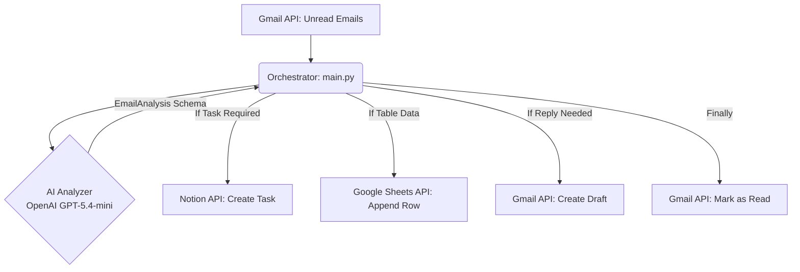

# Smart Email Triage & Automation Agent

An AI-powered email assistant designed to automate inbox management. It connects to Gmail, uses **GPT-5.4 mini** with Structured Outputs to classify emails, extracts actionable items to Notion, logs data to Google Sheets, and drafts context-aware replies.

Built for production readiness using modern Python tooling (`uv`, `pydantic>=2.0`) and native vendor SDKs.

## 🚀 Key Features

- **Automated Ingestion**: Periodically fetches unread emails via the Gmail API.
- **AI Triage & Extraction**: Uses OpenAI's `gpt-5.4-mini` (via structured `beta.chat.completions.parse`) to accurately classify importance, extract data, and decide on necessary actions.
- **Task Management**: Automatically creates detailed task cards in a Notion database for actionable emails.
- **Data Logging**: Appends structured summary data to a Google Sheet (e.g., tracking leads, invoices, or inquiries).
- **Smart Drafts**: Generates polite, context-aware draft replies directly in the Gmail thread.

## 🏗️ Architecture

The project is structured into modular clients orchestrated by a central asynchronous pipeline.



### Modules
- `ai_analyzer.py`: Manages the Pydantic schemas and OpenAI API calls to ensure strict JSON output.
- `auth.py`: Handles Google OAuth2 flow and token storage.
- `gmail_client.py`: Wrapper for fetching emails, extracting plain text bodies, and creating drafts.
- `notion_client.py`: Wrapper for the Notion SDK.
- `sheets_client.py`: Wrapper for appending rows to Google Sheets.

## 🛠️ Setup & Installation

### Prerequisites
- Python 3.12+
- [`uv`](https://github.com/astral-sh/uv) (Ultra-fast Python package installer and resolver)

### 1. Install Dependencies
Initialize the virtual environment and install dependencies:
```bash
python -m uv venv
python -m uv pip install -e .
```

### 2. Environment Variables
Create a `.env` file in the root directory:
```env
OPENAI_API_KEY=sk-proj-...
NOTION_API_KEY=ntn_...
NOTION_DATABASE_ID=abc123def456...
GOOGLE_SHEETS_ID=xyz123abc456...
GOOGLE_SHEETS_RANGE=Sheet1!A:E
```

### 3. Google Credentials
1. Go to the [Google Cloud Console](https://console.cloud.google.com/).
2. Enable the **Gmail API** and **Google Sheets API**.
3. Create OAuth 2.0 Client IDs (Desktop App).
4. Download the JSON file and save it as `credentials.json` in the root of the project.

## 🏃 Usage

Run the main orchestration agent:

```bash
# Using the virtual environment
.venv/Scripts/python src/gmail_operations_agent/main.py
```
*Note: On the first run, a browser window will open to authenticate your Google Account. A `token.json` file will be generated for subsequent runs.*

## 📄 License
This project is licensed under the MIT License - see the [LICENSE](LICENSE) file for details.