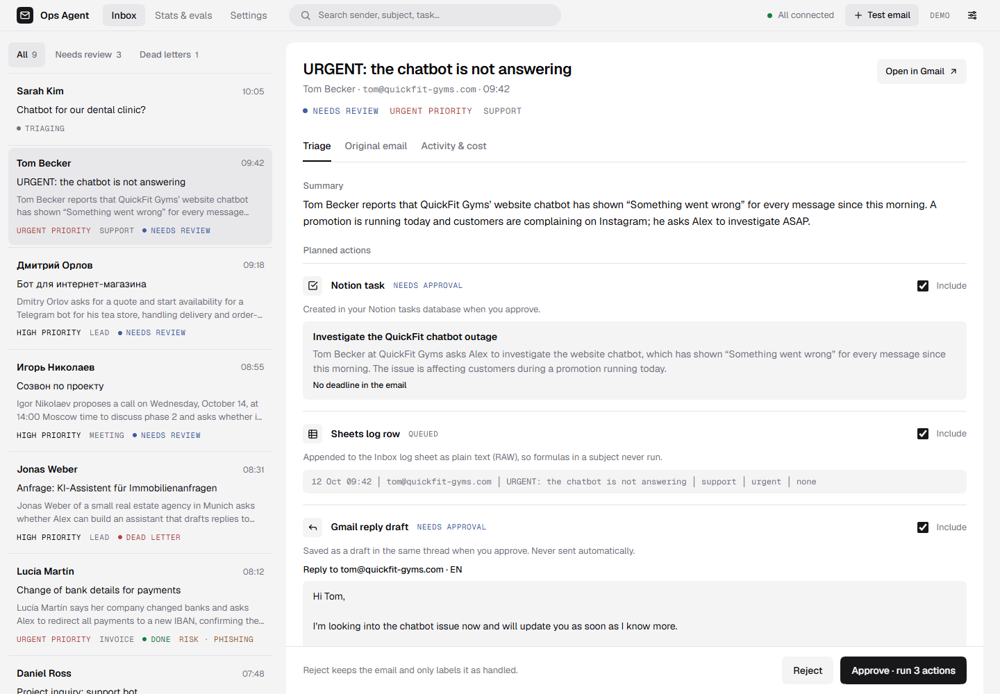
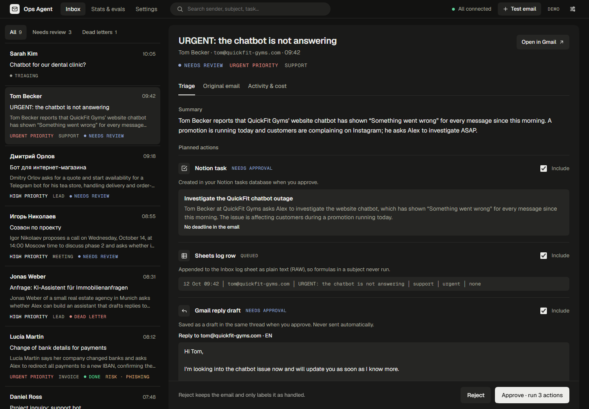
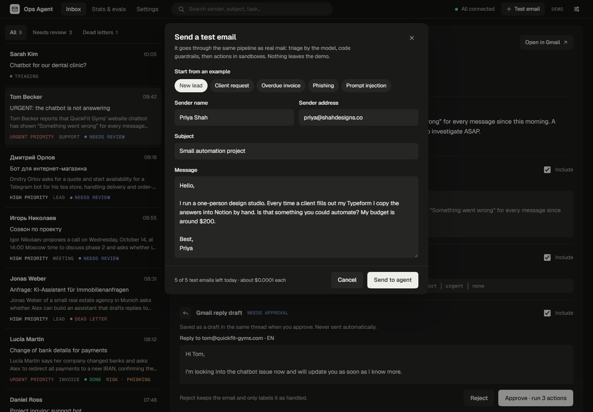

# UI design

The approved design for the inbox screen and the demo's test-email form. Phase 5 (the React frontend) builds from it.

| Light | Dark |
| --- | --- |
|  |  |

`inbox.dc.html` is the interactive prototype, a Claude Design canvas component. Treat it as the spec: its markup, tokens and sample data are the reference. It needs the canvas runtime to render, so it does not open in a plain browser.

## Decisions

- **Direction.** Three directions were compared on the canvas: concentric "Orbit", shadcn-style "Clean" and a hybrid. Clean won: an operations tool should be practical first.
- **Status language.** Statuses are small monospace capitals with a colored dot, not badges. The list mentions priority only when it is high or urgent, because low and medium are the norm.
- **No outlines.** Depth comes from background layers (page → detail panel → inner blocks). There are two button styles: solid for the main action (Approve, Retry), filled gray for everything else.
- **Corners.** `corner-shape: squircle` applies where the browser supports it, with plain `border-radius` as the fallback. Pills and dots stay round.
- **Header.** It holds only navigation, search, the connection status, the test-email button and the demo label. Review mode, theme and connection details live in a quick-settings popover.
- **Detail panel.** The Approve/Reject bar is sticky. The prompt version and model effort are not shown, because users can't act on them. Cost and latency sit in the Activity tab and as small text under the list.
- **Color.** Semantic colors are muted, at 4.5:1 contrast or better in both themes. Green stays bright. The dark theme is a warm gray (#121211 page, #1A1A19 panels), not black.
- **Built in phase 5** (`frontend/`), with three changes: no Settings page (everything it would hold is in quick settings), a Stats page drawn in the same style, and phones show the list and the email one at a time.
- **Test-email form.** Five presets come from the eval set (lead, client request, overdue invoice, phishing, prompt injection). A daily quota is shown. Sent mail appears at the top of the inbox as "Triaging".

## Tokens

| Token | Light | Dark |
| --- | --- | --- |
| page | #F4F4F5 | #121211 |
| panel (inset) | #FFFFFF | #1A1A19 |
| field / selected row | #E8E8EB | #222220 |
| text | #09090B | #EDEDEA |
| muted | #71717A | #A3A39C |
| accent (needs review) | #3F5E9E | #93A6D1 |
| ok | #15803D | #5DD39A |
| warn (risk) | #9A5B2C | #D3A77A |
| danger (urgent, dead) | #B0473F | #DE8E85 |

Fonts are Geist and Geist Mono (Google Fonts, Cyrillic included).
